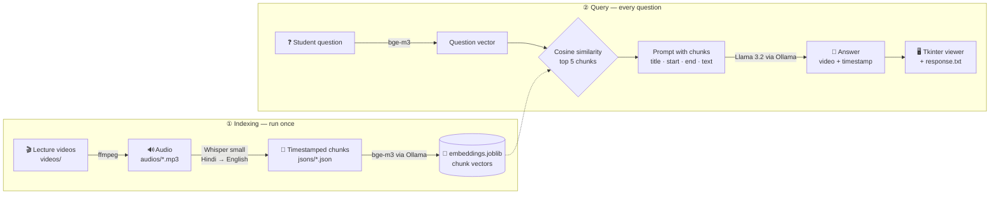
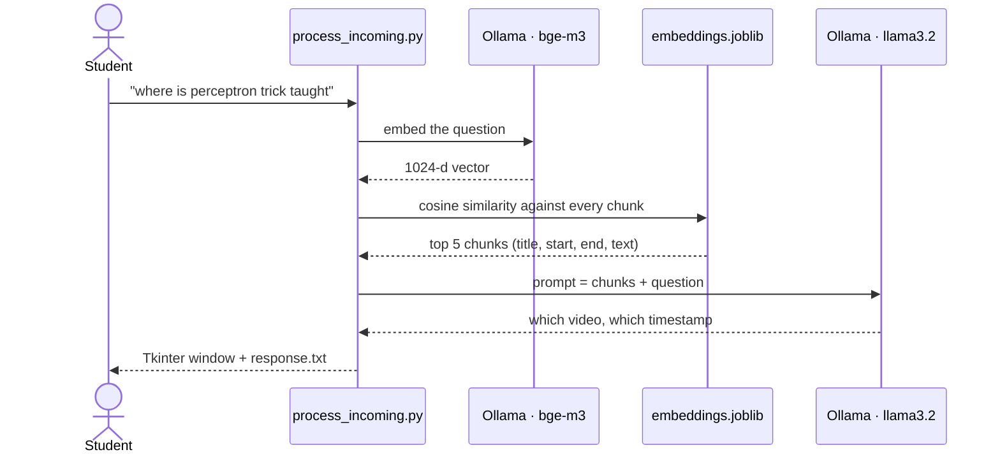

# 🎓 AI Teaching Assistant

**Ask a question about a lecture series and get sent to the exact video and timestamp where it is taught.**

A retrieval-augmented generation (RAG) pipeline over lecture videos. Lectures are transcribed with Whisper, split into timestamped chunks, embedded with **bge-m3**, searched by cosine similarity, and answered by **Llama 3.2**. Everything runs locally through [Ollama](https://ollama.com): no API keys and no cloud calls.


---

## 🧭 How it works

The pipeline has two phases: **indexing**, run once over your videos, and **querying**, run for every question.



### One question, step by step



---

## 💡 Example

**Question**

```
where is perceptron trick taught
```

**Top chunks retrieved**

| Video | Start (s) | End (s) | Transcript |
|---|---|---|---|
| Logistic Regression Perceptron Trick | 1667.0 | 1669.0 | In perceptron trick |
| Logistic Regression Part – Loss Function | 8.1 | 11.04 | And we first read the perceptron trick |
| Logistic Regression Perceptron Trick | 370.0 | 373.0 | So let's understand what is the Perceptron trick |
| Logistic Regression Perceptron Trick | 326.0 | 329.0 | And this approach is called Perceptron trick |
| Logistic Regression Perceptron Trick | 769.0 | 771.0 | In perceptron type |

**Answer** (from `response.txt`)

> The Perceptron trick is primarily discussed in the video "Logistic Regression Perceptron Trick". Start from that video to understand the concept…

The full prompt and response from this run are in [`prompt.txt`](prompt.txt) and [`response.txt`](response.txt).

---

## 🛠️ Tech stack

| Stage | Tool |
|---|---|
| Video → audio | `ffmpeg` |
| Speech → text | OpenAI Whisper (`small`), Hindi audio translated to English |
| Embeddings | `bge-m3` via Ollama (1024-d) |
| Vector store | pandas DataFrame saved with `joblib` |
| Retrieval | scikit-learn cosine similarity, top 5 |
| Answer generation | `llama3.2` via Ollama |
| Interface | Tkinter response window |

---

## 📁 Project structure

```
AI-Teaching-Assistant/
├── videos_to_mp3.py      # ① videos/  → audios/*.mp3        (ffmpeg)
├── mp3_to_jsons.py       # ② audios/  → jsons/*.json        (Whisper, timestamped chunks)
├── preprocess_json.py    # ③ jsons/   → embeddings.joblib   (bge-m3 embeddings)
├── process_incoming.py   # ④ question → top-5 chunks → Llama 3.2 → answer window
├── embeddings.py         #    scratch test of the embeddings endpoint (not needed)
├── prompt.txt            #    last prompt sent to the LLM
└── response.txt          #    last answer from the LLM
```

---

## 🚀 Getting started

### Prerequisites

- Python 3.9+
- [ffmpeg](https://ffmpeg.org/download.html) on your `PATH`
- [Ollama](https://ollama.com/download) running locally, with both models pulled:

```bash
ollama pull bge-m3
ollama pull llama3.2
```

### Install

```bash
git clone https://github.com/Anurag9557/AI-Teaching-Assistant.git
cd AI-Teaching-Assistant
pip install openai-whisper pandas numpy scikit-learn joblib requests
mkdir videos audios jsons
```

### Run on your own lectures

| Step | Command | What it does |
|---|---|---|
| 1 | *(copy files)* | Put your lecture videos in `videos/` |
| 2 | `python videos_to_mp3.py` | Extracts audio to `audios/` |
| 3 | `python mp3_to_jsons.py` | Transcribes each file into timestamped chunks in `jsons/` |
| 4 | `python preprocess_json.py` | Embeds every chunk and saves `embeddings.joblib` |
| 5 | `python process_incoming.py` | Asks for your question and opens the answer in a window |

> **English lectures?** `mp3_to_jsons.py` is set up for Hindi audio (`language="hi"`, `task="translate"`). For English audio, change these to `language="en"` and `task="transcribe"`.

### Skip indexing with precomputed embeddings

Embeddings for the original Data Science lecture series are available here:
**[embeddings.joblib (Google Drive)](https://drive.google.com/file/d/16lO67HTDNp8a67Hjwygl5l2fzrWHarDT/view?usp=sharing)**

Put the file in the project root and go straight to step 5. You only need to re-run step 4 (`preprocess_json.py`) when you add new videos or transcripts.

---

## ⚙️ Customising

| What | Where |
|---|---|
| Whisper model size (`small`) | `mp3_to_jsons.py` |
| Audio language and translate/transcribe | `mp3_to_jsons.py` |
| Embedding model (`bge-m3`) | `preprocess_json.py`, `process_incoming.py` |
| LLM (`llama3.2`; `deepseek-r1` is commented out because it is slower) | `process_incoming.py` |
| Number of chunks retrieved (`top_results = 5`) | `process_incoming.py` |
| Course name and answer style in the prompt | `process_incoming.py` |

---

## 🔮 Possible improvements

- Merge neighbouring Whisper segments into larger chunks so each retrieved hit carries more context
- Format timestamps as `mm:ss` and return clickable links to the moment in the video
- Swap the joblib DataFrame for a vector index (FAISS or Chroma) as the course grows
- Replace the Tkinter window with a Streamlit or Gradio chat interface
- Add a `requirements.txt`
